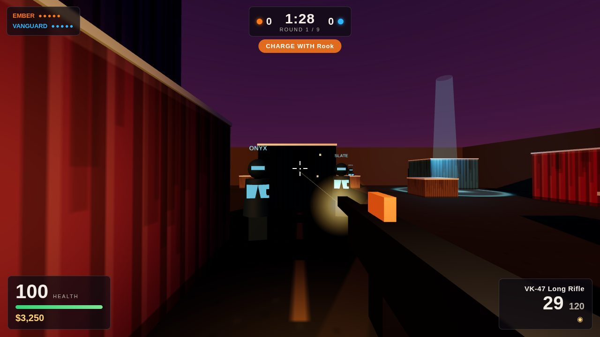
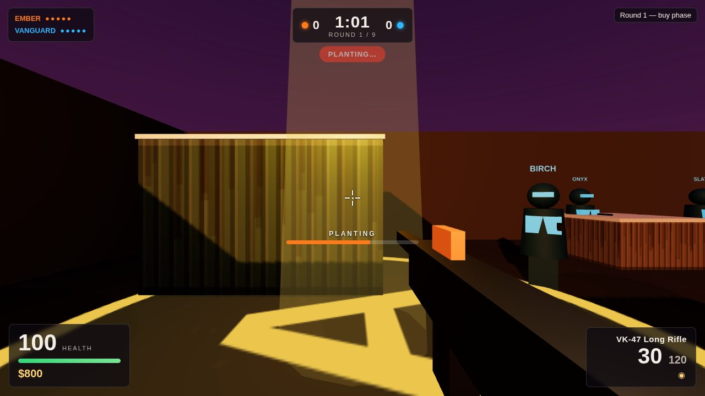
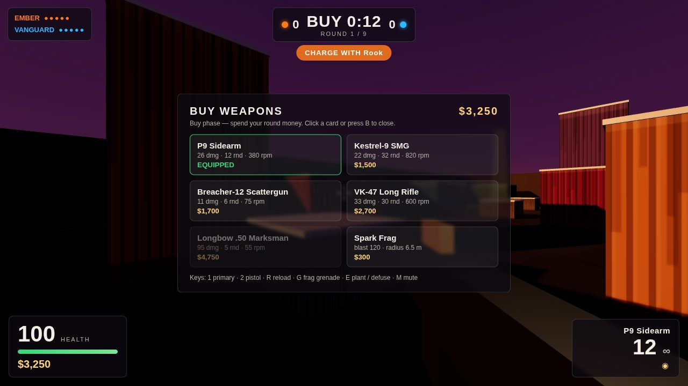
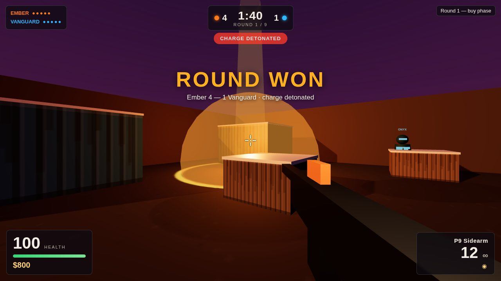

# EMBERLINE — Three.js Tactical FPS

[](https://make.fun/bounty/threejs-fps-01?utm_source=github&utm_medium=readme&utm_campaign=threejs-fps-01)
[](https://make.fun/bounty/threejs-fps-01/leaderboard?utm_source=github&utm_medium=readme&utm_campaign=threejs-fps-01)
[](https://make.fun/bounty/threejs-fps-01?utm_source=github&utm_medium=readme&utm_campaign=threejs-fps-01)

**A 5v5 round-based tactical shooter in a dusk container yard. Plant the charge, hold the sites, and make every bullet count — stopping to aim pays.**

Built for the [make.fun threejs-fps-01 bounty](https://make.fun/bounty/threejs-fps-01). Runs entirely offline from static files: no build step, no network, no audio files — just open `game/index.html` in desktop Chrome and deploy.






## The game

You are **FBI**, an Ember attacker in **Harbor Yard** — a 44 × 36 m container yard at dusk, three lanes, two bomb sites, one low sun throwing long shadows across rust, teal and ochre steel. Your team of five faces five Vanguard defenders. First to 5 rounds wins the match (max 9).

- **Plant the charge** at Site A or B (hold **E**, 3 s) — or wipe out the defenders. A planted charge detonates after 35 s unless a defender defuses it (5 s). Lose the carrier and the charge drops: walk over it to pick it up.
- **Money buys guns.** Start with $800; kills pay $300, planting pays $300, a round win pays $3,250, a loss pays $1,900 plus a loss-streak bonus. Spend it in the buy menu (**B**) between rounds.
- **Five weapons + a frag.** P9 Sidearm, Kestrel-9 SMG, Breacher-12 scattergun, VK-47 long rifle, Longbow .50 marksman — plus the Spark Frag grenade. Headshots deal ×4 damage.
- **Gunplay that punishes spraying.** Recoil, spread that grows while moving and firing, and acceleration-based movement: stop, aim, tap.
- **Bots that play the objective.** They route over a waypoint graph (BFS), hold angles, strafe and burst-fire in fights, push sites, plant, rotate to defuse, and pick up a dropped charge. They hear gunfire and react to it.
- **Full HUD:** health, ammo, round timer, score, money, team alive counts, bomb status, kill feed, hitmarkers, plant/defuse progress — plus a round-win banner and a sniper scope.

## Controls

| Key | Action |
| --- | --- |
| **W A S D** | Move |
| **Mouse** | Aim (click the game to lock the pointer) |
| **Click** | Fire |
| **R** | Reload |
| **B** | Buy menu |
| **E** (hold) | Plant / defuse the charge |
| **G** | Throw a frag grenade |
| **1 / 2** | Primary / pistol |
| **Right mouse** | Scope (Longbow .50) |
| **Ctrl / C** | Crouch |
| **Space** | Jump |
| **M** | Mute |

## Play it

```sh
node serve.ts        # serves game/ at http://localhost:8080
```

Open http://localhost:8080 in desktop Chrome, click **DEPLOY**, and play. `main.ts` hands the entry in: it copies `game/` and `screenshots/` to the output directory and writes `dossier.json` with the kit's `buildDossier`.

```sh
MAKEFUN_OUTPUT_DIR=out node main.ts
```

## How it is built

- `game/src/main.js` — the fixed-step (1/60 s) game loop, combat, grenades, rounds
- `game/src/match.js` — pure round/economy/charge state machine (no DOM, no three.js)
- `game/src/world.js` — Harbor Yard: obstacles, sites, spawns, waypoint graph + BFS, line of sight
- `game/src/bots.js` — bot brains: routing, holding, engaging, planting, defusing
- `game/src/weapons.js` — the armoury and the shared fire model (spread, recoil, falloff, headshots)
- `game/src/player.js` — first-person movement with acceleration, crouch, jump
- `game/src/render.js` — the dusk look: low sun, long shadows, fog, procedural textures, tracers, muzzle flash
- `game/src/audio.js` — fully synthesized WebAudio sounds (no audio files)
- `game/src/hud.js` — the HUD, kill feed, buy menu and banners
- `game/src/util.js` — small shared math helpers

All art is procedural (canvas textures, no fetched assets) and all sounds are synthesized, so the game plays with zero network requests. three.js 0.187.0 is vendored under `game/vendor/three/`.

## License

MIT — see [LICENSE](LICENSE).
